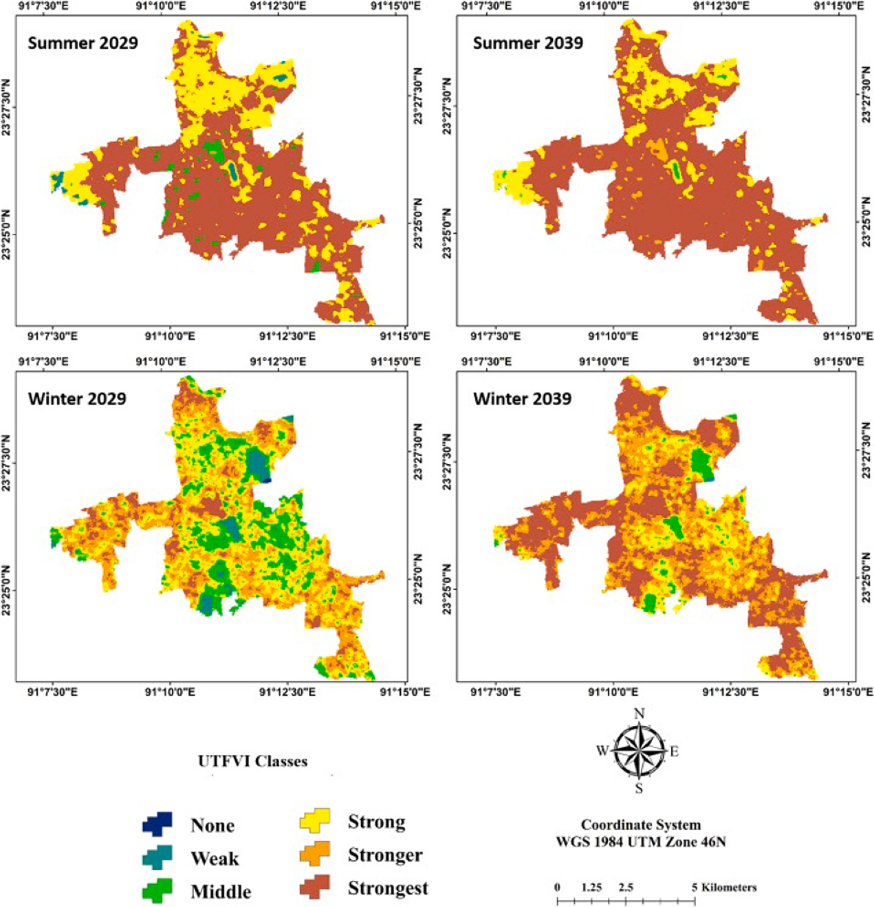
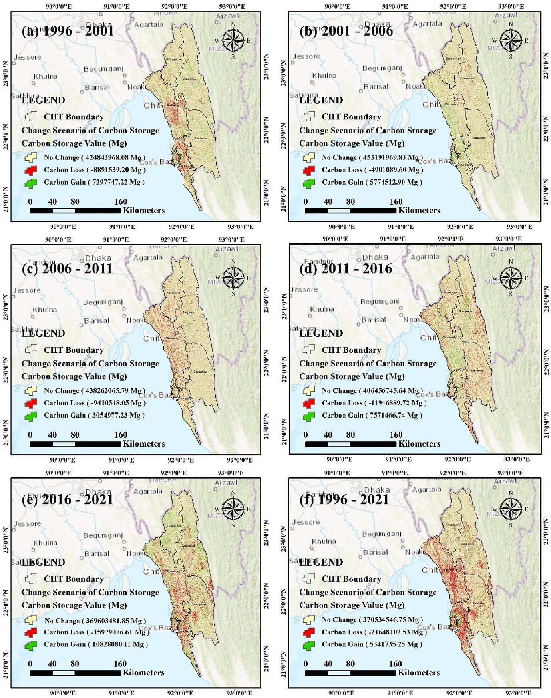
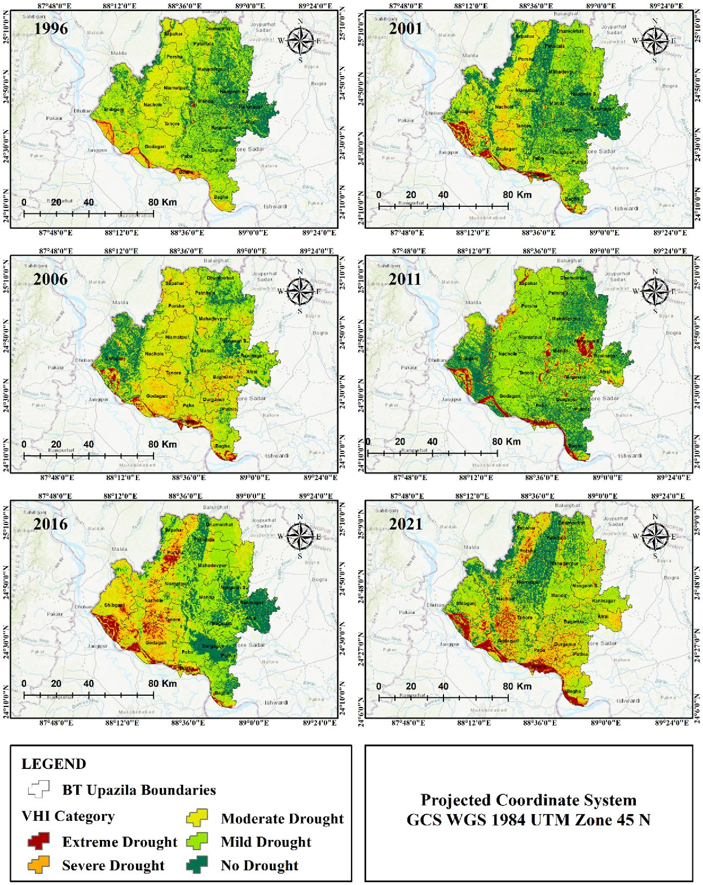
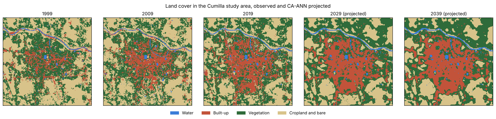

# landsat-climate-ml

[](https://github.com/AbdullaKafy/landsat-climate-ml/actions/workflows/ci.yml)
[](https://colab.research.google.com/github/AbdullaKafy/landsat-climate-ml/blob/main/examples/cumilla_2021/workflow.ipynb)
[](LICENSE)

**Land cover change, surface heat, carbon and drought from Landsat, in open Python.**

This repository is the code side of a series of peer-reviewed studies by
Abdulla Al Kafy and co-authors (11 papers, 2021 to 2024, about 1,180 citations).
The studies share one method chain:

```
Landsat scenes ─► land cover map ─► surface temperature, UHI, UTFVI
                        │                     │
                        ├─► carbon stock      ├─► drought (VCI, TCI, VHI)
                        └─► CA-ANN land change ─► future land cover and heat
```

The original analyses were done with desktop GIS, Google Earth Engine scripts and
the QGIS MOLUSCE plugin, and those project files were not kept. This repository
rebuilds each step as a small, tested Python function, and links every published
figure and table to the function that makes that kind of output.

## Published studies

**Urban heat and land change (Landsat, CA-ANN)**

| Study | Place and years | Journal | Author | Cited | Headline result |
|---|---|---|---|---|---|
| [Seasonal UTFVI prediction with machine learning](papers/2021-scs-cumilla-seasonal-utfvi) | Cumilla, Bangladesh, 1999 to 2039 | Sustainable Cities and Society | 1st | 212 | Urban area 20.45 → 26.31 km² (1999 to 2019); 37.06% of the city projected at or above 33 °C in summer 2039 |
| [Land cover change and seasonal UTFVI](papers/2022-be-sylhet-seasonal-utfvi) | Sylhet, Bangladesh, 1995 to 2030 | Building and Environment | 1st | 146 | Built-up 14.52% → 52.66% of the city (1995 to 2020), 58.93% projected for 2030 |
| [Land cover change and urban thermal characteristics](papers/2022-scs-kuwait-lulc-utfvi) | Kuwait, 1991 to 2031 | Sustainable Cities and Society | 2nd | 110 | Built-up +5,024 km² (1991 to 2021); strongest UTFVI zone +108% |
| [Urban expansion, seasonal LST and UHI](papers/2022-enb-sylhet-urban-expansion-lst) | Sylhet, Bangladesh, 1995 to 2030 | Energy and Buildings | 2nd | 80 | Built-up area vs mean summer UHI: r = 0.982 |
| [Microscale land cover change with cellular automata](papers/2022-ese-penang-ca-lulc) | Penang, Malaysia, 2005 to 2035 | Earth Systems and Environment | 2nd | 40 | Built-up 468 → 1,082 km² (2005 to 2020); CA kappa 0.96 |
| [Day and night LST, carbon storage and prediction](papers/2024-jem-coxsbazar-lst-carbon) | Cox's Bazar, Bangladesh, 1996 to 2041 | Journal of Environmental Management | 1st | 22 | Mean daytime LST 27.72 → 31.78 °C (1996 to 2021) |

**Vegetation and carbon**

| Study | Place and years | Journal | Author | Cited | Headline result |
|---|---|---|---|---|---|
| [Vegetation loss, surface temperature and carbon emission](papers/2022-be-penang-vegetation-carbon) | Penang, Malaysia, 1996 to 2021 | Building and Environment | 2nd | 201 | Forest 47.72% → 30.62%; carbon emission vs LST r = 0.83 to 0.93 |
| [Forest cover change and carbon storage (InVEST, GEE)](papers/2023-ei-cht-forest-carbon) | Chittagong Hill Tracts, Bangladesh, 1996 to 2021 | Ecological Indicators (open access) | 1st | 120 | Vegetation −2,863 km²; carbon storage 495.93 → 479.63 × 10⁶ Mg |
| [Vegetation cover loss, surface temperature and carbon](papers/2022-be-cumilla-vegetation-carbon) | Cumilla, Bangladesh, 1994 to 2019 | Building and Environment | 1st | 112 | Very good vegetation 43.35% → 14.53%; maximum LST 27.61 → 39.28 °C |

**Drought and national analytics**

| Study | Place and years | Journal | Author | Cited | Headline result |
|---|---|---|---|---|---|
| [Index-based agricultural drought (VCI, TCI, VHI) and prediction](papers/2023-stoten-barind-drought) | Barind Tract, Bangladesh, 1996 to 2031 | Science of the Total Environment | 1st | 94 | Extreme drought area 184 → 571 km² (1996 to 2021); prediction AUC 0.96 |
| [Urban expansion and environmental parameters (GEE)](papers/2024-jem-saudi-urban-analytics) | Saudi Arabia, 1987 to 2022 | Journal of Environmental Management | 2nd | 39 | Mean PM2.5 44.25 → 73.36 µg/m³; PCA ranks PM2.5, UTFVI, NO2 highest |

Citation counts from Crossref, October 29, 2026. A twelfth study, on green roofs and lidar in Austin, has its own repository: [green-roof-cooling-lidar](https://github.com/AbdullaKafy/green-roof-cooling-lidar).

Each study folder has a plain summary, key numbers, one or two selected figures
from the paper, a **method → code** table, a **figure and table map**, the paper's
own result tables as CSV files, and a `sample.py` that runs the method on small
synthetic data in seconds (`python papers/<study>/sample.py`). Numbers are copied
from the published papers and cited to the table they come from. Only selected
figures are shown; the DOI links lead to the full papers.

| Predicted UTFVI, Cumilla 2029 and 2039 | Carbon storage change, Chittagong Hill Tracts | Drought (VHI), Barind Tract |
|---|---|---|
|  |  |  |

## Toolkit

| Module | What it does | Used in |
|---|---|---|
| `data` | Landsat Collection 2 Level-2 seasonal composites, Copernicus DEM, ESA WorldCover, from the Microsoft Planetary Computer (no account needed) | all |
| `indices` | NDVI, NDBI, NDWI, MNDWI, SAVI, EVI, BSI | all |
| `thermal` | LST from brightness temperature, emissivity, UHI, UTFVI and classes, area per temperature range, statistics by land cover | heat papers |
| `lulc` | Random Forest land cover with spatial holdout, accuracy (overall, kappa, producer, user), change matrix, gain and loss | all |
| `caann` | Markov chain + neural network cellular automata (CA-ANN) land change, kappa and chi-square validation | prediction papers |
| `lstmodel` | Neural network that predicts LST from land cover, scored with spatial block cross-validation | prediction papers |
| `carbon` | Carbon stock and change from land cover pools (InVEST Carbon style) | carbon papers |
| `drought` | VCI, TCI, VHI and drought classes | drought paper |
| `zones` | Directional sectors and distance rings around a city center | directional analysis |
| `stats` | Correlation and regression line, ROC AUC, cross profiles | all |

```bash
pip install "landsat-climate-ml[download] @ git+https://github.com/AbdullaKafy/landsat-climate-ml"
```

```python
from landsat_climate import thermal, lulc, caann

u = thermal.utfvi(lst_c)                 # UTFVI from LST in °C
cls = thermal.classify_utfvi(u)          # None ... Strongest
areas = lulc.class_areas(lulc_2019)      # km² per class
table = lulc.change_matrix(lulc_2009, lulc_2019)
```

## Worked example: Cumilla, 1999 to 2039

[`examples/cumilla_2021/`](examples/cumilla_2021) runs the full chain on real data
for the study area of the 2021 *Sustainable Cities and Society* paper: download,
land cover, CA-ANN projection to 2029 and 2039, seasonal LST and UTFVI. The prepared
inputs (about 10 MB) are included, so the notebook runs in about 3 minutes with no
download.



This example is a teaching rebuild on today's Landsat Collection 2 data, not a
copy of the published analysis. Its numbers differ from the paper; the example's
README explains each difference. For the published results, see the paper folder.

## Tests

```bash
pip install -e ".[dev]"
pytest -q
ruff check .
```

Tests run on small synthetic arrays and need no download.

## Citation

If this code helps your work, please cite the paper whose method you use (each
paper folder has the full citation) and this repository (see `CITATION.cff`).

## License

Code: MIT. Paper tables are reproduced as data with citation; the papers remain
under their publishers' terms. Data in `examples/` keep their source licenses.
