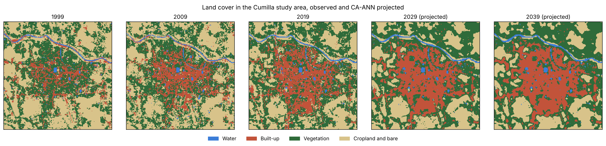
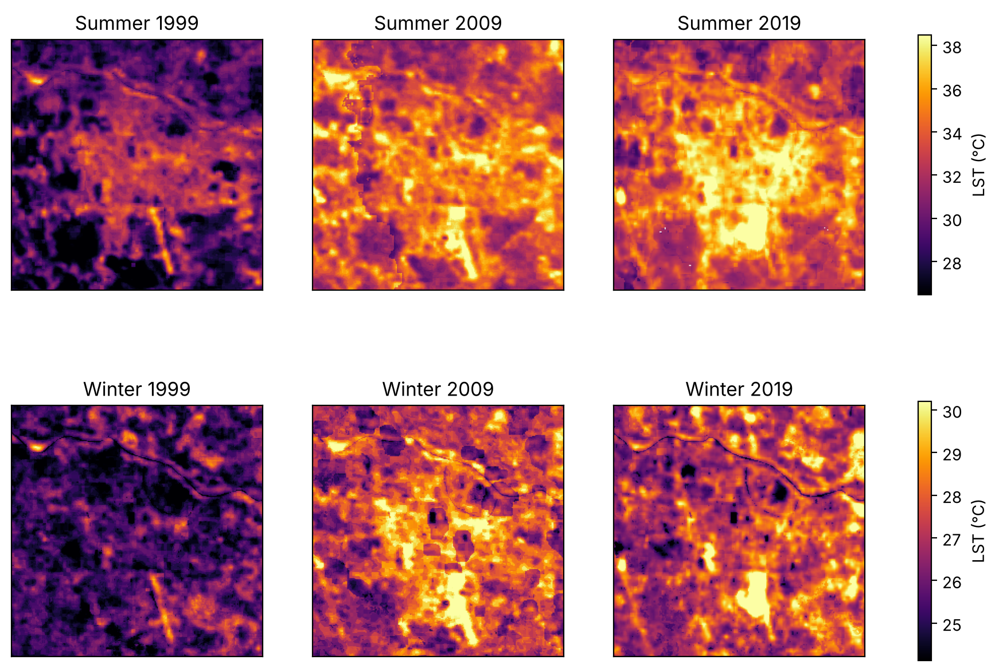
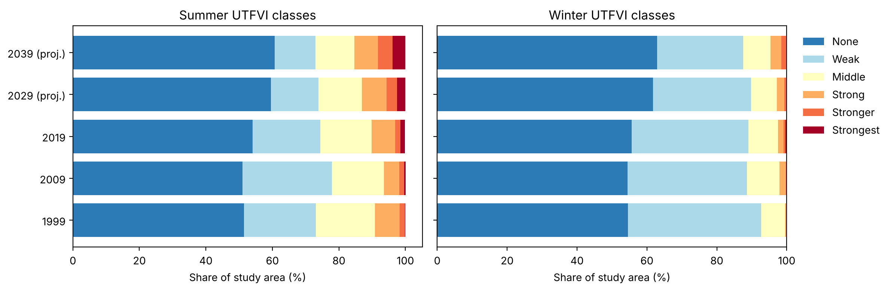

# Worked example: Cumilla, Bangladesh, 1999 to 2039

[](https://colab.research.google.com/github/AbdullaKafy/landsat-climate-ml/blob/main/examples/cumilla_2021/workflow.ipynb)
[](https://doi.org/10.1016/j.scs.2020.102542)

This folder runs the full toolkit chain on real, open data for the study area of:

> Kafy, A.-A., Abdullah-Al-Faisal, Rahman, M. S., Islam, M., Al Rakib, A., Islam, M. A., Khan, M. H. H., Sikdar, M. S., Sarker, M. H. S., Mawa, J., and Sattar, G. S. (2021).
> Prediction of seasonal urban thermal field variance index using machine learning algorithms in Cumilla, Bangladesh.
> *Sustainable Cities and Society*, 64, 102542. https://doi.org/10.1016/j.scs.2020.102542

The published results, copied from the paper's tables, are in
[`papers/2021-scs-cumilla-seasonal-utfvi`](../../papers/2021-scs-cumilla-seasonal-utfvi).
This example is different: it shows how to run the same kind of analysis yourself.

> **Reproduction note.** This is a teaching rebuild, not the original analysis.
> The 2020 study used Landsat Collection 1 scenes, an SVM classifier, desktop GIS,
> the MOLUSCE plugin and MATLAB, and those files were not kept. Here the same steps
> run on today's Landsat Collection 2 data with open libraries. Results agree with
> the paper in direction but not in exact value. The differences are listed below.



## What the workflow does

| Step | Paper | This repository |
|---|---|---|
| Imagery | Landsat 5 TM (1999, 2009) and Landsat 8 OLI/TIRS (2019), winter and summer | Same sensors and years. Median seasonal composites of all clear scenes, Collection 2 Level-2, from the Microsoft Planetary Computer |
| Land cover | Supervised classification, 4 classes | Random Forest, 4 classes (water, built-up, vegetation, cropland and bare), trained on 2019 with ESA WorldCover 2020 labels |
| LST | Computed from the thermal band with emissivity correction | Collection 2 surface temperature product (already emissivity corrected) |
| Land change model | CA-ANN in MOLUSCE, validated on 2019 | CA-ANN in scikit-learn: Markov matrix sets class totals, a neural network scores each pixel, cells are assigned greedily. Validated by simulating 2019 from 2009 |
| Future LST | ANN from land cover to LST | MLP regression from land cover, neighborhood class shares and elevation, scored with spatial block cross-validation |
| UTFVI | (Ts minus Tmean) / Ts, six classes | Same formula and class breaks (after Zhang et al., 2006) |

## Results from this rebuild

| Measure | Paper (Tables 2, 3, 8, 9, 10) | This rebuild |
|---|---|---|
| Built-up growth, 2019 to 2029 / 2039 (points of total area) | +7.87 / +11.03 | +3.9 / +6.7 percentage points (21.7% to 25.6% / 28.4%) |
| Vegetation change, 2019 to 2029 / 2039 (points) | -9.48 / -13.75 | +1.0 / +1.0 points (see note 4) |
| Summer LST, built-up minus vegetation (2019) | about 4 °C | 3.1 °C (37.0 vs 34.0 °C) |
| Area at or above 33 °C in summer | 3.04 km² in 2019; 32.77% (2029) and 37.06% (2039) projected | 64.5% observed in 2019; 63.7% (2029) and 66.2% (2039) projected |
| Strongest UTFVI class, summer | rising | 1.4% (2019), 2.5% (2029), 3.9% (2039) |
| Land cover accuracy | overall 86.04%, 84.82%, 87.23% (1999, 2009, 2019; SVM) | overall 0.80, kappa 0.69 (held-out spatial blocks vs WorldCover) |
| CA-ANN check on 2019 | kappa 0.86, 89.41% correct | agreement 0.717, kappa 0.572 (a no-change map scores 0.695, 0.535) |
| LST model | summer 2019: RMSE 0.53, R 0.87 | summer R² 0.70, RMSE 1.29 °C; winter R² 0.30, RMSE 1.10 °C |

This example's tables are in [`outputs/`](outputs).





## Why the numbers differ (read before you reuse)

1. **Study area.** The paper's boundary (about 45.25 km²) is not available as open
   data, so this example uses a 53.04 km² square centered on the city. It holds
   much more farmland, so built-up shares are lower than in the paper (21.7% vs
   58.1% in 2019).
2. **Data version.** Collection 2 surface temperature replaces the paper's own LST
   calculation. Median composites replace single scenes.
3. **Land cover labels.** Training labels come from ESA WorldCover 2020, not from
   field or image-interpreted samples. To use one model for Landsat 5 and Landsat 8,
   every feature is standardized within its own year (median and interquartile
   range). This removes sensor offsets but assumes the overall mix of surfaces is
   similar between years, so 1999 and 2009 shares are estimates.
4. **Vegetation trend.** In this rebuild vegetation stays flat and new built-up land
   comes mostly from cropland. In the paper it came largely from vegetation. The
   WorldCover "tree cover" class around Cumilla includes homestead gardens next to
   cropland, which may explain part of the gap.
5. **CA-ANN skill is modest.** The simulated 2019 map beats a no-change map, but only
   by about 2 points of agreement. This is normal for 10-year land change, where most
   pixels do not change, and it is why the null model is reported next to it.
6. **Fixed climate.** Projected LST uses the 2019 relationship between land cover and
   temperature. It shows the effect of land cover change only, not regional warming.
7. **1999 summer timing.** The 1999 summer composite has only March and early April
   scenes, so it is cooler than later years partly for that reason.

## Run it

```bash
git clone https://github.com/AbdullaKafy/landsat-climate-ml.git
cd landsat-climate-ml
pip install -e ".[dev]"
cd examples/cumilla_2021
jupyter lab workflow.ipynb      # about 3 minutes on a laptop
```

The prepared data (about 10 MB) are already in [`data/`](data). To download them
again, or to try another city, edit `CENTER` and `AREA_KM2` in `download.py`:

```bash
pip install -e "../..[download]"
python download.py
```

No account or API key is needed.

## Files

```
download.py      step 1: Landsat composites, DEM and WorldCover for the study box
workflow.ipynb   steps 2 to 5: land cover, CA-ANN, LST model, UTFVI
data/            prepared inputs (see data/README.md)
outputs/         result tables (CSV, JSON)
figures/         figures made by the notebook
```

## Data credits

Landsat data courtesy of the U.S. Geological Survey. Copernicus GLO-30 DEM and ESA
WorldCover 2020 (CC BY 4.0) from the European Space Agency. Map center from
OpenStreetMap. Details and licenses in [`data/README.md`](data/README.md).
