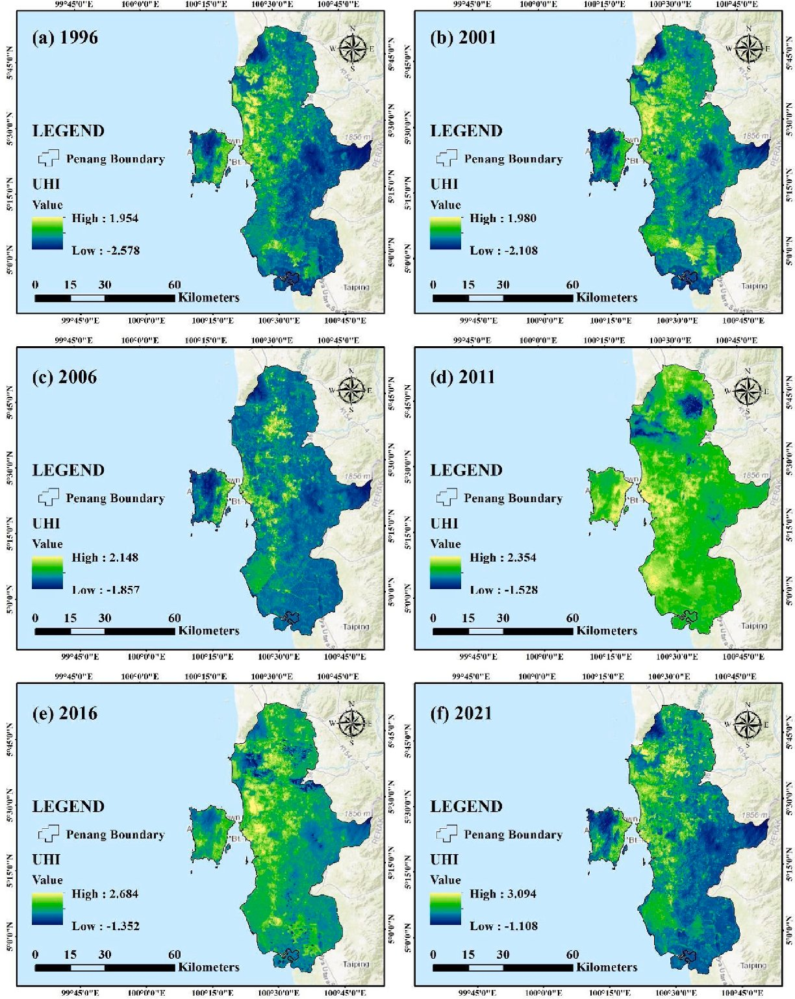
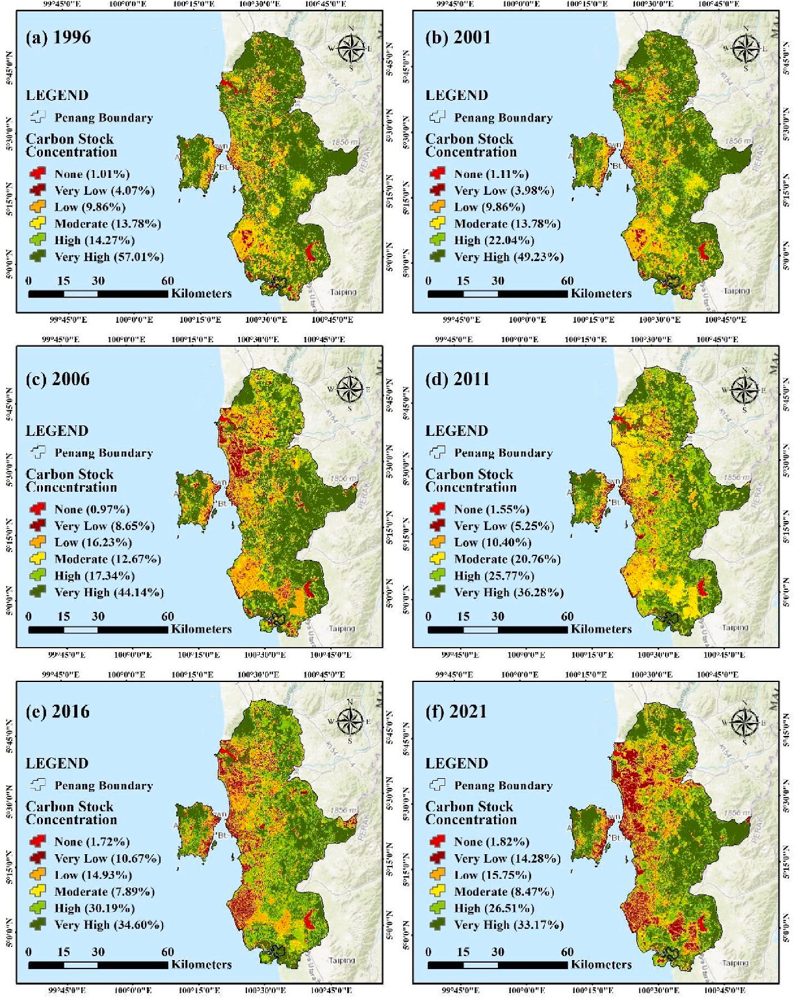

# Vegetation loss, heat island and carbon in Penang

> Rahaman, Z.A., Kafy, A.-A., Saha, M., Abdul Rahim, A., Almulhim, A.I., Rahaman, S.N., Fattah, M.A., Rahman, M.T., S, K., Faisal, A.-A., Al Rakib, A. (2022). Assessing the impacts of vegetation cover loss on surface temperature, urban heat island and carbon emission in Penang city, Malaysia. *Building and Environment*, 222, 109335. https://doi.org/10.1016/j.buildenv.2022.109335

## In one paragraph

The study looks at Penang Island, Malaysia, from 1996 to 2021. It uses six Landsat scenes (TM for 1996 to 2011, OLI/TIRS for 2016 and 2021) processed in Google Earth Engine. Land cover was mapped into water, built-up, agriculture and forest with an SVM classifier. LST was found from the thermal band and checked against Malaysian Meteorological Department records. UHI was computed as a normalized LST score. Carbon stock was estimated with a tree allometric equation and checked against World Bank emission data (R² = 0.9472). Forest fell from 47.72% of the land in 1996 to 30.62% in 2021. Average LST rose from 22.67 °C to 30.31 °C (7.63 °C, 0.31 °C/year). Maximum UHI rose from 1.954 to 3.094. Very high carbon stock areas fell from 57% to 33%. Carbon emission was strongly linked to LST (r = 0.826 to 0.931) and UHI (r = 0.852 to 0.90), and negatively to NDVI (r = −0.833 to −0.905).

## Selected figures



*Fig. 6. Normalized UHI over Penang from 1996 to 2021. From Rahaman et al. (2022), Building and Environment, [https://doi.org/10.1016/j.buildenv.2022.109335](https://doi.org/10.1016/j.buildenv.2022.109335). Shown by the paper's author; see the article for all figures.*



*Fig. 8. Carbon stock concentration classes over Penang from 1996 to 2021. From Rahaman et al. (2022), Building and Environment, [https://doi.org/10.1016/j.buildenv.2022.109335](https://doi.org/10.1016/j.buildenv.2022.109335). Shown by the paper's author; see the article for all figures.*

## Key numbers

- Overall accuracy 93.10% to 95.95%; kappa 90.78 to 94.60 (Table 2).
- LST minus station temperature: average deviation from −0.495 °C (1996) to 0.11 °C (2006) (Table 3).
- Maximum LST rose from 26.37 °C (1996) to 35.28 °C (2021); minimum from 18.97 °C to 25.32 °C (Table 3).
- Average LST rose from 22.67 °C (1996) to 30.31 °C (2021), 7.63 °C or 0.31 °C/year (Section 3.2, Fig. 5).
- Maximum UHI rose from 1.954 to 3.094; minimum from −2.578 to −1.108 (Section 3.3, Fig. 6).
- Estimated carbon emission versus World Bank data: R² = 0.9472 (Fig. 2).
- NDVI vs carbon emission r = −0.833 to −0.905; carbon emission vs LST r = 0.826 to 0.931; carbon emission vs UHI r = 0.852 to 0.90; all N = 46, p < 0.001 (Tables 4, 5, 6).
- Forest cover fell from 47.72% (1996) to 30.62% (2021); very high carbon stock areas fell from 57% to 33% (Section 4).

## Method → code

| Step | Paper | Toolkit function |
|---|---|---|
| Get imagery | Six Landsat scenes from GEE, path/row 128/56 | `data.search_scenes`, `data.load_composite` (toolkit uses C2 L2 median composites; the paper used single C1 Level-1 scenes) |
| Land cover map | SVM classification in GEE, four classes | `lulc.train_classifier` (Random Forest; paper used SVM) |
| Accuracy | Confusion matrix, overall accuracy, kappa | `lulc.accuracy` |
| NDVI | (NIR − RED) / (NIR + RED) | `indices.ndvi` |
| Emissivity | E = 0.004 PV + 0.986, PV squared | `thermal.emissivity_from_ndvi` |
| LST | Radiance, brightness temperature, emissivity-corrected LST | `thermal.lst_from_bt` |
| LST check | Compare with station max and min temperature | not included: simple difference against station records |
| UHI | (Ts − Tm) / SD | `thermal.uhi` |
| Carbon stock | Allometric AGB, carbon = 0.5 × biomass | not included: needs field tree data; the toolkit uses per-class carbon pools (`carbon.stock_map`) instead |
| Carbon check | Correlation with World Bank emission data | `stats.correlation` |
| Carbon by class | Carbon stock categories by LULC and NDVI class | `thermal.stats_by_class` |
| Cross-section | ArcGIS profile graph tool, four lines over carbon maps | `stats.cross_profile` |
| Relationships | Regression, Pearson r, t-test (NDVI vs CE, CE vs LST, CE vs UHI) | `stats.correlation` |

## Figures and tables in the paper

| Item | What it shows | Toolkit function |
|---|---|---|
| [Fig. 1](https://doi.org/10.1016/j.buildenv.2022.109335) | Location of Penang in Malaysia | map / layout |
| [Fig. 2](https://doi.org/10.1016/j.buildenv.2022.109335) | Estimated carbon emission versus World Bank records | `stats.correlation` |
| [Fig. 3](https://doi.org/10.1016/j.buildenv.2022.109335) | Method flowchart | map / layout |
| [Fig. 4](https://doi.org/10.1016/j.buildenv.2022.109335) | Land cover maps for six years | `lulc.train_classifier` |
| [Fig. 5](https://doi.org/10.1016/j.buildenv.2022.109335) | LST maps for six years | `thermal.lst_from_bt` |
| [Fig. 6](https://doi.org/10.1016/j.buildenv.2022.109335) | UHI maps for six years | `thermal.uhi` |
| [Fig. 7](https://doi.org/10.1016/j.buildenv.2022.109335) | NDVI vegetation class maps | `indices.ndvi` |
| [Fig. 8](https://doi.org/10.1016/j.buildenv.2022.109335) | Carbon stock concentration maps | not included (field allometry) |
| [Fig. 9](https://doi.org/10.1016/j.buildenv.2022.109335) | Carbon stock profiles across land cover classes | `stats.cross_profile` |
| [Fig. 10](https://doi.org/10.1016/j.buildenv.2022.109335) | Carbon stock categories within each land cover class | `thermal.stats_by_class` |
| [Fig. 11](https://doi.org/10.1016/j.buildenv.2022.109335) | Carbon stock categories within each NDVI class | `thermal.stats_by_class` |
| [Fig. 12](https://doi.org/10.1016/j.buildenv.2022.109335) | NDVI versus carbon emission scatter plots | `stats.correlation` |
| [Fig. 13](https://doi.org/10.1016/j.buildenv.2022.109335) | Carbon emission versus LST scatter plots | `stats.correlation` |
| [Fig. 14](https://doi.org/10.1016/j.buildenv.2022.109335) | Carbon emission versus UHI scatter plots | `stats.correlation` |
| [Table 1](https://doi.org/10.1016/j.buildenv.2022.109335) | Landsat scenes used | `data.search_scenes` |
| [Table 2](https://doi.org/10.1016/j.buildenv.2022.109335) | Confusion matrices and accuracy per year | `lulc.accuracy` |
| [Table 3](https://doi.org/10.1016/j.buildenv.2022.109335) | Landsat LST versus station temperature | not included |
| [Table 4](https://doi.org/10.1016/j.buildenv.2022.109335) | Correlation and t-test, NDVI versus carbon emission | `stats.correlation` |
| [Table 5](https://doi.org/10.1016/j.buildenv.2022.109335) | Correlation and t-test, carbon emission versus LST | `stats.correlation` |
| [Table 6](https://doi.org/10.1016/j.buildenv.2022.109335) | Correlation and t-test, carbon emission versus UHI | `stats.correlation` |

## Published tables as data

- `tables/table1_landsat_scenes.csv`: dates, scene IDs, sensor, cloud cover, path/row, as printed.
- `tables/table2_confusion_matrix.csv`: confusion matrix per year, with totals, user and producer accuracy (%).
- `tables/table2_accuracy_summary.csv`: overall accuracy (%) and kappa (× 100) per year.
- `tables/table3_lst_validation_c.csv`: Landsat LST and station max/min (°C), deviation and average deviation (°C).
- `tables/table4_ndvi_vs_ce_correlation.csv`: Pearson r, N, t, df, significance per year.
- `tables/table5_ce_vs_lst_correlation.csv`: Pearson r, N, t, df, significance per year.
- `tables/table6_ce_vs_uhi_correlation.csv`: Pearson r, N, t, df, significance per year.

## Sample code

The script makes synthetic LST maps for four years, computes UHI, estimates tree carbon at 46 points with the paper's allometric equation, and prints the correlation of carbon stock with LST and UHI.

```bash
python papers/2022-be-penang-vegetation-carbon/sample.py
```

Key calls:

```python
uhi = thermal.uhi(lst)  # (LST - mean) / SD

agb = 0.0673 * (1.54 * dbh**2 * height) ** 0.976  # kg
stock = 0.5 * agb  # kg C per point

r_lst = stats.correlation(stock, lst[pts[:, 0], pts[:, 1]])
r_uhi = stats.correlation(stock, uhi[pts[:, 0], pts[:, 1]])
print(r_lst["r"], r_uhi["r"], r_lst["n"])
```

## Notes

- LST is in °C. UHI is a unitless z-score: UHI = (Ts − Tm) / SD, with Tm and SD the mean and standard deviation of LST.
- PV is squared here: PV = ((NDVI − NDVImin) / (NDVImax − NDVImin))². This matches the `thermal.emissivity_from_ndvi` default (`squared=True`).
- For Landsat 8, band 10 radiance was corrected with Oi = 0.29 (Lλ = ML × QCAL + AL − Oi).
- Table 2 is printed as a picture. It was read by eye; the recomputed kappa matches the printed kappa for all six years. Two printed values do not match the matrix: 1996 agriculture user accuracy (printed 92.31, matrix 64/69 = 92.75) and 2001 agriculture producer accuracy (printed 94.94, matrix 58/60 = 96.67). The 2006 overall accuracy is printed 94.16 (matrix 94.17). The CSVs keep the printed values.
- Table 1 dates are in June, but the text says April, and the day-of-year in some scene IDs does not match the dates. The CSV copies Table 1 as printed.
- Text says the 1996 minimum LST is 18.94 °C; Table 3 says 18.97 °C.
- The six NDVI classes (no vegetation to very good) are named but the class breaks are not given.
- Carbon came from field tree data, not per-class pools, so there is no carbon-by-class table. Correlations use N = 46 points per year.

Only selected figures are shown here. See the paper at the DOI above for the full set.
