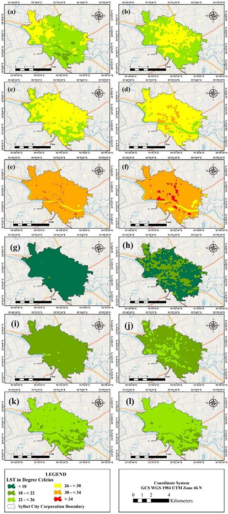
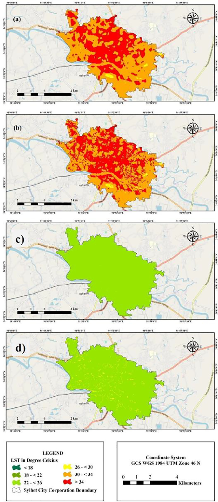

# Urban expansion, seasonal LST and surface UHI in Sylhet, Bangladesh

> Milan Saha, Abdulla - Al Kafy, Arpita Bakshi, Abdullah-Al- Faisal, Abdulaziz I. Almulhim, Zullyadini A. Rahaman, Abdullah Al Rakib, Md. Abdul Fattah, Kaniz Shaleha Akter, Muhammad Tauhidur Rahman, Maomao Zhang, R. Rathi (2022). Modelling microscale impacts assessment of urban expansion on seasonal surface urban heat island intensity using neural network algorithms. *Energy & Buildings*, 275, 112452. https://doi.org/10.1016/j.enbuild.2022.112452

## In one paragraph

The study area is Sylhet City Corporation (SCC), Bangladesh, 26.57 km². The authors used 12 Landsat scenes (Landsat 4-5 TM and Landsat 8 OLI), one summer and one winter scene every five years from 1995 to 2020. They classified land cover with a supervised classifier. They computed seasonal LST and a surface UHI index in six classes. They studied urban growth by 16 directions around the city core. They correlated LST and UHI with NDBI, NDBSI, NDVI and NDWI. A CA-ANN model (MOLUSCE plugin) predicted built-up land for 2025 and 2030. An ANN on a 500 m grid predicted seasonal LST and UHI. Built-up land grew from 6.44 km² (2000) to 13.99 km² (2020). Built-up area correlates with mean summer UHI at r = 0.982 and with mean winter LST at r = 0.964. In summer, the area above 34 °C is predicted to grow from 2.146 km² (2020) to 11.227 km² (2030).

## Selected figures



*Fig. 5. Summer (a to f) and winter (g to l) LST in Sylhet City Corporation from 1995 to 2020. From Saha et al. (2022), Energy and Buildings, [10.1016/j.enbuild.2022.112452](https://doi.org/10.1016/j.enbuild.2022.112452). Shown by the paper's author; see the article for all figures.*



*Fig. 16. Predicted summer (a, b) and winter (c, d) LST for 2025 and 2030. From Saha et al. (2022), Energy and Buildings, [10.1016/j.enbuild.2022.112452](https://doi.org/10.1016/j.enbuild.2022.112452). Shown by the paper's author; see the article for all figures.*

## Key numbers

- Land cover maps: overall accuracy 93.34 % to 95.34 %, kappa 91.03 to 93.73 (Table 2).
- Summer area above 34 °C: 0.367 km² (2015) and 2.146 km² (2020) (Table 3).
- Summer area in the High UHI class (2.25 to 3): 0.258 km² (1995) and 2.65 km² (2020) (Table 4).
- Pearson r between built-up area and mean summer UHI: 0.982; with mean summer LST: 0.910 (Table 5).
- Pearson r between built-up area and mean winter LST: 0.964; with mean winter UHI: 0.911 (Table 6).
- ANN LST check, overall kappa: 0.97708 (summer 2015) and 0.9684 (summer 2020) (Table 8).
- Predicted summer area above 34 °C: 10.440 km² (2025) and 11.227 km² (2030) (Table 9).
- Predicted summer 2030 UHI: High 7.069 km² and Very High 2.015 km² (Table 11).

## Method → code

| Step | Paper | Toolkit function |
|---|---|---|
| Get scenes | 12 single Landsat scenes, path/row 136/43, cloud < 10 % | `data.search_scenes`, `data.load_composite` (toolkit uses Collection 2 Level 2 median composites, not single scenes) |
| Land cover map | "Supervised classification"; the algorithm is not named; 4 classes | `lulc.train_classifier` (Random Forest) |
| Accuracy | Confusion matrix of 300 points per year; user, producer, overall accuracy and kappa | `lulc.accuracy` |
| Built-up area and conversion | Built-up km² per year; conversion of other classes to built-up | `lulc.class_areas`, `lulc.change_matrix` |
| Expansion speed, intensity, center of gravity | Mue, Iue, gravity center shift distance and angle | `lulc.expansion_indices`, `zones.gravity_center` |
| LST | Radiance from DN, brightness temperature, LST with emissivity 0.97 to 0.99 | `thermal.lst_from_bt`, `thermal.emissivity_from_ndvi` (the paper used a fixed emissivity range, not an NDVI method) |
| LST range areas | km² in six ranges (< 18 to > 34 °C) | `thermal.range_areas` |
| LST check | Landsat LST vs BMD Sylhet station data, R² > 0.90 in summer | `stats.correlation` |
| UHI | Normalized LST, then UHI in six classes (< 0 to > 3) and URI | `thermal.uhi` (check that the class breaks match) |
| Directional change | Rings around the city core cut into 16 directions | `zones.directional_sectors`, `zones.concentric_rings`, `zones.share_by_zone` |
| Index correlations | Pearson r of LST and UHI with NDBI, NDBSI, NDVI, NDWI, and with DEM | `indices.ndbi`, `indices.bsi`, `indices.ndvi`, `indices.ndwi`, `stats.correlation` (BSI is close to, but not the same as, NDBSI) |
| Mean LST by land cover | Zonal statistics of LST per class | `thermal.stats_by_class` |
| Built-up vs mean LST and UHI | Pearson r over the six years (n = 6) | `stats.correlation` |
| Future built-up land | CA with ANN (MLP) in MOLUSCE, QGIS 2.18; drivers: DEM, aspect, slope, distance to roads and rivers, urban footprint | `caann.transition_matrix`, `caann.CAANN` |
| Land cover model check | Kappa for 2015 and 2020; ROC/AUC | `caann.kappa`, `stats.roc_auc` |
| Future LST and UHI | ANN on a 500 m grid with past LST, LULC, NDBI, NDBSI, lat, lon (and UHI for the UHI model) | `lstmodel.fit_lst_model`, `lstmodel.predict_lst` (scikit-learn MLP; the paper used a 500 m grid) |

## Figures and tables in the paper

| Item | What it shows | Toolkit function |
|---|---|---|
| [Fig. 1](https://doi.org/10.1016/j.enbuild.2022.112452) | Study area location | map / layout |
| [Fig. 2](https://doi.org/10.1016/j.enbuild.2022.112452) | Flow diagram of the method | map / layout |
| [Fig. 3](https://doi.org/10.1016/j.enbuild.2022.112452) | Built-up area, 1995 to 2020 | `lulc.train_classifier` |
| [Fig. 4](https://doi.org/10.1016/j.enbuild.2022.112452) | Other classes converted to built-up, by period | `lulc.change_matrix` |
| [Fig. 5](https://doi.org/10.1016/j.enbuild.2022.112452) | Summer and winter LST maps | `thermal.lst_from_bt` |
| [Fig. 6](https://doi.org/10.1016/j.enbuild.2022.112452) | Summer and winter UHI maps | `thermal.uhi` |
| [Fig. 7](https://doi.org/10.1016/j.enbuild.2022.112452) | Built-up area by direction | `zones.share_by_zone` |
| [Fig. 8](https://doi.org/10.1016/j.enbuild.2022.112452) | Seasonal LST by direction | `zones.share_by_zone` |
| [Fig. 9](https://doi.org/10.1016/j.enbuild.2022.112452) | Seasonal UHI by direction | `zones.share_by_zone` |
| [Fig. 10](https://doi.org/10.1016/j.enbuild.2022.112452) | Seasonal LST ranges by land cover class | `thermal.range_areas` |
| [Fig. 11](https://doi.org/10.1016/j.enbuild.2022.112452) | Seasonal UHI classes by land cover class | `lulc.change_matrix` |
| [Fig. 12](https://doi.org/10.1016/j.enbuild.2022.112452) | ROC curves for 2015 and 2020 | `stats.roc_auc` |
| [Fig. 13](https://doi.org/10.1016/j.enbuild.2022.112452) | Predicted built-up area, 2025 and 2030 | `caann.CAANN` |
| [Fig. 14](https://doi.org/10.1016/j.enbuild.2022.112452) | Predicted conversion to built-up, four periods | `lulc.change_matrix` |
| [Fig. 15](https://doi.org/10.1016/j.enbuild.2022.112452) | Spider chart of % converted to built-up | `lulc.gain_loss` |
| [Fig. 16](https://doi.org/10.1016/j.enbuild.2022.112452) | Predicted summer and winter LST maps | `lstmodel.predict_lst` |
| [Fig. 17](https://doi.org/10.1016/j.enbuild.2022.112452) | Spider chart of LST range area change | `thermal.range_areas` |
| [Fig. 18](https://doi.org/10.1016/j.enbuild.2022.112452) | Predicted summer and winter UHI maps | `lstmodel.predict_lst` |
| [Fig. 19](https://doi.org/10.1016/j.enbuild.2022.112452) | Spider chart of UHI class area change | `thermal.uhi` |
| [Fig. A.1](https://doi.org/10.1016/j.enbuild.2022.112452) | Landsat LST vs station LST, 1995 to 2020 | `stats.correlation` |
| [Fig. A.2](https://doi.org/10.1016/j.enbuild.2022.112452) | Predicted LST vs station LST, 2015 and 2020 | `stats.correlation` |
| [Fig. A.3](https://doi.org/10.1016/j.enbuild.2022.112452) | % of each class converted to built-up | `lulc.change_matrix` |
| [Fig. A.4](https://doi.org/10.1016/j.enbuild.2022.112452) | % of city in each LST range | `thermal.range_areas` |
| [Fig. A.5](https://doi.org/10.1016/j.enbuild.2022.112452) | % of city in each UHI class | `thermal.uhi` |
| [Fig. A.6](https://doi.org/10.1016/j.enbuild.2022.112452) | UHI class area change, 1995 to 2020 | `thermal.uhi` |
| [Fig. A.7](https://doi.org/10.1016/j.enbuild.2022.112452) | LST vs NDBI, NDBSI, NDVI, NDWI | `stats.correlation` |
| [Fig. A.8](https://doi.org/10.1016/j.enbuild.2022.112452) | UHI vs NDBI, NDBSI, NDVI, NDWI | `stats.correlation` |
| [Fig. A.9](https://doi.org/10.1016/j.enbuild.2022.112452) | UHI vs elevation (DEM) | `stats.correlation` |
| [Fig. A.10](https://doi.org/10.1016/j.enbuild.2022.112452) | Mean seasonal LST per land cover class | `thermal.stats_by_class` |
| [Table 1](https://doi.org/10.1016/j.enbuild.2022.112452) | Landsat scenes used | `data.search_scenes` |
| [Table 2](https://doi.org/10.1016/j.enbuild.2022.112452) | Confusion matrices and accuracy per year | `lulc.accuracy` |
| [Table 3](https://doi.org/10.1016/j.enbuild.2022.112452) | Seasonal LST area by range | `thermal.range_areas` |
| [Table 4](https://doi.org/10.1016/j.enbuild.2022.112452) | Seasonal UHI area by class | `thermal.uhi` |
| [Table 5](https://doi.org/10.1016/j.enbuild.2022.112452) | Built-up vs summer mean LST and UHI correlation | `stats.correlation` |
| [Table 6](https://doi.org/10.1016/j.enbuild.2022.112452) | Built-up vs winter mean LST and UHI correlation | `stats.correlation` |
| [Table 7](https://doi.org/10.1016/j.enbuild.2022.112452) | Kappa check of predicted built-up area | `caann.kappa` |
| [Table 8](https://doi.org/10.1016/j.enbuild.2022.112452) | Kappa check of predicted seasonal LST | `caann.kappa` |
| [Table 9](https://doi.org/10.1016/j.enbuild.2022.112452) | Predicted seasonal LST area by range | `thermal.range_areas` |
| [Table 10](https://doi.org/10.1016/j.enbuild.2022.112452) | Kappa check of predicted seasonal UHI | `caann.kappa` |
| [Table 11](https://doi.org/10.1016/j.enbuild.2022.112452) | Predicted seasonal UHI area by class | `thermal.uhi` |

## Published tables as data

- `tables/table1_landsat_scenes.csv`: month, year, scene ID and sensor of the 12 scenes.
- `tables/table2_lulc_accuracy.csv`: confusion matrix (300 points) per year with user, producer, overall accuracy and kappa.
- `tables/table3_lst_range_area_km2.csv`: summer and winter area (km²) in six LST ranges, 1995 to 2020.
- `tables/table4_uhi_area_km2.csv`: summer and winter area (km²) in six UHI classes, 1995 to 2020.
- `tables/table5_summer_correlation.csv`: Pearson r, 2-tailed p and n for built-up area, mean summer LST and UHI.
- `tables/table6_winter_correlation.csv`: Pearson r, 2-tailed p and n for built-up area, mean winter LST and UHI.
- `tables/table7_builtup_prediction_kappa.csv`: MOLUSCE % correctness and kappa for predicted built-up area.
- `tables/table8_ann_lst_validation_kappa.csv`: % correctness and kappa for predicted seasonal LST.
- `tables/table9_predicted_lst_area_km2.csv`: predicted summer and winter LST range area for 2025 and 2030.
- `tables/table10_ann_uhi_validation_kappa.csv`: % correctness and kappa for predicted seasonal UHI.
- `tables/table11_predicted_uhi_area_km2.csv`: predicted summer and winter UHI class area for 2025 and 2030.

## Sample code

The script grows a small synthetic city, links built-up area to mean seasonal LST, and predicts the area in each LST range for 2025 and 2030. Synthetic data, so the numbers will not match the paper.

```bash
python papers/2022-enb-sylhet-urban-expansion-lst/sample.py
```

```python
built = [lulc.class_areas(lc[y])["Built-up"] for y in lc]
r = stats.correlation(built, [lst["Summer", y].mean() for y in lc])["r"]
ca = caann.CAANN(neighborhood=3, seed=0).fit(lc[2015], lc[2020], dem)
lc[2025] = ca.step(lc[2020], dem, caann.transition_matrix(lc[2015], lc[2020]))
model, score = lstmodel.fit_lst_model(lc[2020], dem, lst["Summer", 2020], n_splits=3)
lst["Summer", 2025] = lstmodel.predict_lst(model, lc[2025], dem)
areas = thermal.range_areas(lst["Summer", 2025], (18, 22, 26, 30, 34))  # km² per range
```

## Notes

- LST is in °C. Areas are in km². Every row of Tables 3, 4, 9 and 11 adds up to 26.57 km², the city area.
- Empty cells in Tables 3, 4, 9 and 11 are blank in the paper. Because each row adds to 26.57 km², a blank cell means no area in that class.
- LST ranges: < 18, 18 to < 22, 22 to < 26, 26 to < 30, 30 to < 34, > 34 °C.
- UHI classes: None < 0, Very Low 0 to 0.75, Low 0.75 to 1.5, Moderate 1.5 to 2.25, High 2.25 to 3, Very High > 3. The methods text gives a min-max normalization, (LST - Tmin) / (Tmax - Tmin), and a UHI ratio index (URI). The paper does not say how the normalized raster maps to these class values.
- LST constants as printed: Landsat 4-5 K1 = 607.7 and K2 = 1260.6; Landsat 8 K1 = 774.9 and K2 = 321.07 (the usual Band 10 K2 is 1321.08); ML = 0.0003342, AL = 0.1; rho = 1.438 × 10⁻² mK; emissivity 0.97 to 0.99.
- Table 7: the 2020 overall kappa is printed as "0.i9658". We left the cell empty. The text gives "98.66 % and 97.45 % kappa overall value", which match the Kappa (loc) column.
- Tables 5 and 6 are not symmetric in the printed p values: built-up vs summer UHI is 0.003 in one cell and 0.002 in the other; built-up vs winter UHI is 0.005 and 0.011. We copied every cell as printed.
- Ring spacing for the directional analysis is 200 m in the methods and 100 m in the results text. The methods also mention a 30 km multiple ring buffer.
- The text says predicted built-up land is 56.62 % and 58.93 % "for 2015 and 2030". Fig. 13 shows the prediction years as 2025 and 2030.

Only selected figures are shown here. See the paper at the DOI above for the full set.
