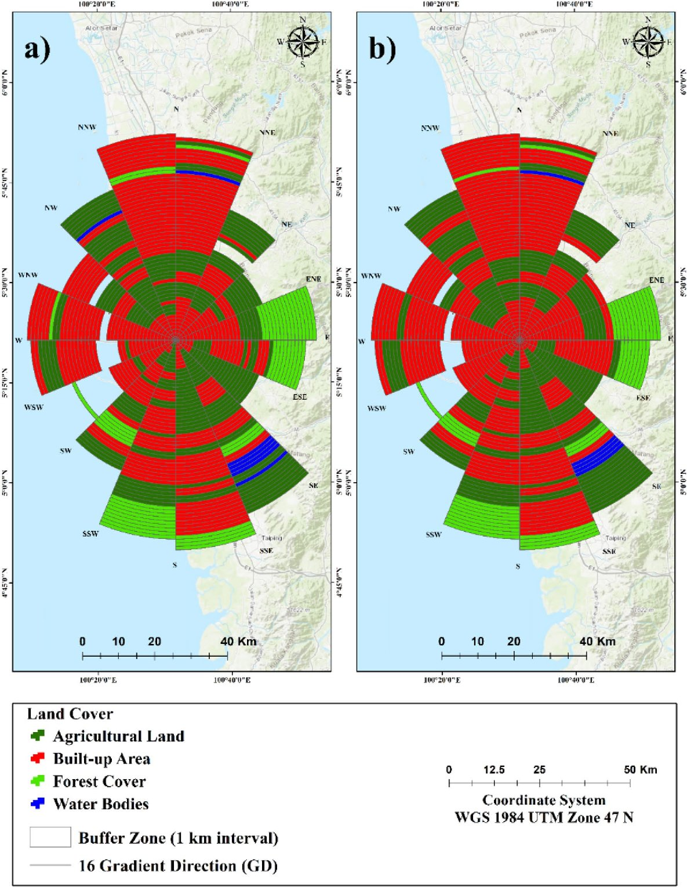

# Land cover change and CA prediction in Penang, Malaysia, 2005 to 2035

> Zullyadini A. Rahaman, Abdulla - Al Kafy, Abdullah-Al- Faisal, Abdullah Al Rakib, Dewan Md. Amir Jahir, Md. Abdul Fattah, S. Kalaivani, R. Rathi, Saumik Mallik, Muhammad Tauhidur Rahman (2022). Predicting Microscale Land Use/Land Cover Changes Using Cellular Automata Algorithm on the Northwest Coast of Peninsular Malaysia. *Earth Systems and Environment*, 6, 817-835. [https://doi.org/10.1007/s41748-022-00318-w](https://doi.org/10.1007/s41748-022-00318-w)

## In one paragraph

The study covers Penang state on the northwest coast of Peninsular Malaysia. It uses Landsat 5 TM images for 2005 and 2010 and Landsat 8 OLI images for 2015 and 2020. An SVM with an RBF kernel maps four classes: agricultural land, built-up area, forest and water body. The paper then measures area change, gains and losses, and transformation rates. Concentric rings and 16 direction rays show where each class grew or shrank. A Cellular Automata (CA) model in the QGIS MOLUSCE plugin, driven by slope, elevation and distance to roads and water, projects land cover for 2025 and 2035. Kappa statistics and a Pearson chi-square test validate the model. From 2005 to 2020, built-up land grew from 468.24 to 1081.53 km², a gain of 15.56% of the study area. Agricultural land lost 8.41%, forest 5.57% and water 1.58%.

## Selected figure



*Fig. 10. Predicted land cover for 2025 (a) and 2035 (b), read along 16 direction rays and 1 km rings. From Rahaman et al. (2022), Earth Systems and Environment, [https://doi.org/10.1007/s41748-022-00318-w](https://doi.org/10.1007/s41748-022-00318-w). Shown by the paper's author; see the article for all figures.*

## Key numbers

- Built-up area grew from 468.24 km² (2005) to 1081.53 km² (2020), a net change of 15.56%. (Table 5)
- Agricultural land fell from 2394.29 to 2062.98 km² (−8.41%). Forest fell from 920.77 to 701.09 km² (−5.57%). Water fell from 157.69 to 95.40 km² (−1.58%). (Table 5)
- Built-up land grew by 5.19% per year. Agricultural land fell by 2.80% per year and forest by 1.86% per year. (Table 6)
- Overall classification accuracy was 98, 97, 96 and 98% for 2005, 2010, 2015 and 2020. (Table 4)
- CA validation gave K-location 0.96, K-no 0.95, K-location Strata 0.93, K-standard 0.97, 97.02% correctness and overall kappa 0.96. (Table 2)
- The chi-square between the actual and simulated maps was 0.712, below the critical value of 7.815 (df = 3, α = 0.05). (Table 3)
- The abstract says that by 2035 about 4.68% of agricultural land, 2.77% of forest and 1.03% of water bodies will become built-up land. (Fig. 11)

## Method → code

| Step | Paper | Toolkit function |
|---|---|---|
| Get imagery | Landsat 5 TM (2005, 2010) and Landsat 8 OLI (2015, 2020) scenes from USGS | `data.search_scenes`, `data.load_composite` (the paper used single scenes) |
| Classify land cover | SVM in ENVI 5.3, RBF kernel, 4 classes | `lulc.train_classifier` (Random Forest; the paper used SVM) |
| Accuracy | 300 validation points per year; overall, user and producer accuracy, kappa | `lulc.accuracy` |
| Area change | Class areas and net change as % of study area | `lulc.class_areas` |
| Gains, losses, transitions | Image difference; gain and loss chart; from-to conversions 2005 to 2020 | `lulc.gain_loss`, `lulc.change_matrix` |
| Directional mapping | Concentric rings from the center, 16 direction rays | `zones.concentric_rings`, `zones.directional_sectors`, `zones.share_by_zone` |
| Transition potential | Markov chain transition matrix from LULC pairs; drivers: slope, elevation (30 m SRTM), Euclidean distance to roads and water | `caann.transition_matrix` |
| Prediction | CA in the QGIS MOLUSCE plugin for 2025 and 2035 | `caann.CAANN` |
| Kappa validation | IDRISI/TerrSet kappa set and MOLUSCE % correctness and kappa | `caann.kappa` |
| Chi-square validation | Pearson chi-square on class areas, df = 3, α = 0.05 | `caann.chi_square_validation` |

## Figures and tables in the paper

| Item | What it shows | Toolkit function |
|---|---|---|
| [Fig. 1](https://doi.org/10.1007/s41748-022-00318-w) | Location of Malaysia and Penang | map / layout |
| [Fig. 2](https://doi.org/10.1007/s41748-022-00318-w) | LULC prediction flowchart | map / layout |
| [Fig. 3](https://doi.org/10.1007/s41748-022-00318-w) | Land cover maps 2005, 2010, 2015, 2020 | `lulc.train_classifier` |
| [Fig. 4](https://doi.org/10.1007/s41748-022-00318-w) | Gains and losses per class | `lulc.gain_loss` |
| [Fig. 5](https://doi.org/10.1007/s41748-022-00318-w) | Classes converted to built-up area | `lulc.change_matrix` |
| [Fig. 6](https://doi.org/10.1007/s41748-022-00318-w) | Directional rings for built-up area, four years | `zones.directional_sectors`, `zones.share_by_zone` |
| [Fig. 7](https://doi.org/10.1007/s41748-022-00318-w) | Directional rings for agricultural land | `zones.directional_sectors`, `zones.share_by_zone` |
| [Fig. 8](https://doi.org/10.1007/s41748-022-00318-w) | Directional rings for forest cover | `zones.directional_sectors`, `zones.share_by_zone` |
| [Fig. 9](https://doi.org/10.1007/s41748-022-00318-w) | Directional rings for water bodies | `zones.directional_sectors`, `zones.share_by_zone` |
| [Fig. 10](https://doi.org/10.1007/s41748-022-00318-w) | Directional view of predicted 2025 and 2035 maps | `caann.CAANN`, `zones.share_by_zone` |
| [Fig. 11](https://doi.org/10.1007/s41748-022-00318-w) | Radar chart of class change, 2005 to 2035 | `lulc.class_areas` |
| [Table 1](https://doi.org/10.1007/s41748-022-00318-w) | Landsat sensors, bands and dates | `data.search_scenes` |
| [Table 2](https://doi.org/10.1007/s41748-022-00318-w) | Kappa validation of CA prediction | `caann.kappa` |
| [Table 3](https://doi.org/10.1007/s41748-022-00318-w) | Chi-square of actual vs simulated areas | `caann.chi_square_validation` |
| [Table 4](https://doi.org/10.1007/s41748-022-00318-w) | Confusion matrices and accuracy per year | `lulc.accuracy` |
| [Table 5](https://doi.org/10.1007/s41748-022-00318-w) | Class areas and net change per period | `lulc.class_areas` |
| [Table 6](https://doi.org/10.1007/s41748-022-00318-w) | From-to conversions and rates, 2005 to 2020 | `lulc.change_matrix`, `lulc.gain_loss` |

## Published tables as data

- `tables/table1_landsat_scenes.csv`: year, sensor and acquisition date (band list left out).
- `tables/table2_ca_validation_kappa.csv`: K-location, K-no, K-location Strata, K-standard, % correctness and overall kappa for 2021.
- `tables/table3_chi_square_validation.csv`: actual (O) and simulated (E) class areas with the chi-square terms.
- `tables/table4_lulc_accuracy.csv`: confusion matrices for each year, with user and producer accuracy, overall accuracy and kappa.
- `tables/table5_lulc_area_km2.csv`: class areas in km² for 2005, 2010, 2015 and 2020, and net change in %.
- `tables/table6_lulc_transformation_2005_2020.csv`: area converted to and from each class, and the rates (kept as printed text, for example "8.41% (2.80%/yr)").

## Sample code

The script builds synthetic land cover maps for 2010, 2015 and 2020, checks a CA-ANN model on 2020 with kappa and chi-square, predicts 2025 and 2035, and prints the built-up share in 16 direction sectors.

```bash
python papers/2022-ese-penang-ca-lulc/sample.py
```

Key calls:

```python
model = caann.CAANN(neighborhood=5, seed=0).fit(maps[2010], maps[2015], dem)
m_fit = caann.transition_matrix(maps[2010], maps[2015])
sim2020 = model.step(maps[2015], dem, m_fit)
agree, kappa = caann.kappa(maps[2020], sim2020)
chi = caann.chi_square_validation(maps[2020], sim2020)

m_next = caann.transition_matrix(maps[2015], maps[2020])
pred = {2025: model.step(maps[2020], dem, m_next)}
sectors = zones.directional_sectors((n, n), (60, 60), n=16)
share = zones.share_by_zone(pred[2025], sectors, 2)  # 2 = built-up
```

## Notes

- Areas are in km². The net change % in Table 5 is change divided by the total study area (3941 km²), not by the class area. The script check reproduces every value this way.
- SVM settings: RBF kernel, gamma 0.07, penalty parameter 120.00, pyramid level 0, classification probability threshold 0.05.
- Directional mapping: concentric rings from the study area center and 16 direction rays. The text gives a "5-km interval".
- The Table 3 chi-square areas sum to about 1173 km², which is not the Table 5 scale (3941 km²). The paper does not say why. The chi-square terms do add up to the printed 0.712.
- The text says the null hypothesis is rejected, but 0.712 < 7.815 means it is not rejected. The paper's conclusion (actual and simulated maps are similar) matches "not rejected".
- Validation year: the text and Tables 2 and 3 say 2021. The Fig. 2 flowchart says 2020.
- The kappa values printed in Table 4 (89.01, 88.44, 87.65, 89.33) do not match the printed matrices. The matrices give about 97.27, 96.35, 95.40 and 97.23. The CSV keeps the printed values.
- The conclusion gives a forest decline rate of 0.34%/year and a water decline rate of 0.53%/year. Table 6 gives 1.86%/year for forest and 0.45%/year (decreasing rate) for water. It also says built-up land will "increase up to % by 2035", with the number missing.

Only selected figures are shown here. See the paper at the DOI above for the full set.
