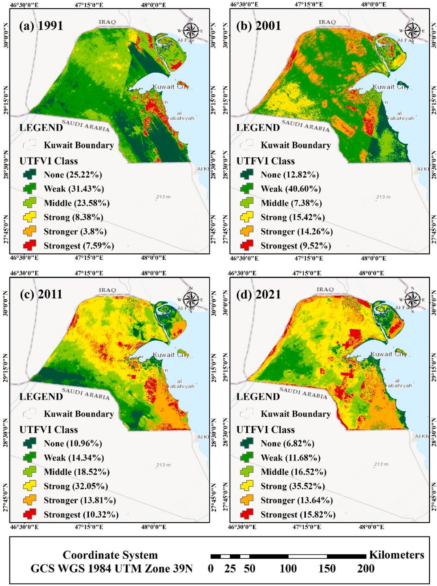
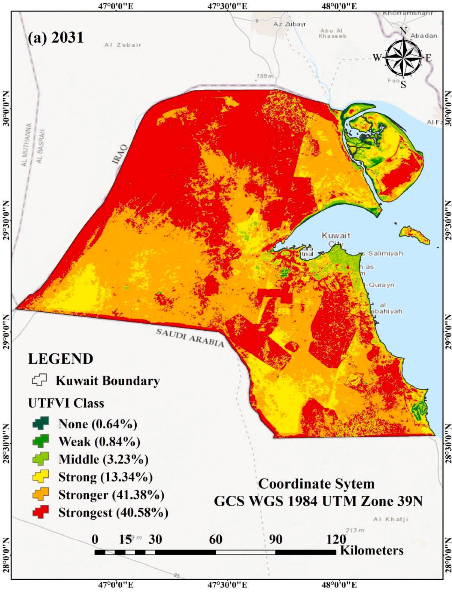

# Land cover change and urban heat in Kuwait, 1991 to 2031

> Ahmad E AlDousari, Abdulla-Al Kafy, Milan Saha, Md. Abdul Fattah, Abdulaziz I. Almulhim, Abdullah-Al- Faisal, Abdullah Al Rakib, Dewan Md. Amir Jahir, Zullyadini A. Rahaman, Arpita Bakshi, Mahir Shahrier, Md. Mijanur Rahman (2022). Modelling the impacts of land use/land cover changing pattern on urban thermal characteristics in Kuwait. *Sustainable Cities and Society*, 86, 104107. [https://doi.org/10.1016/j.scs.2022.104107](https://doi.org/10.1016/j.scs.2022.104107)

## In one paragraph

The study covers Kuwait. It uses summer (July) Landsat 5 TM scenes for 1991, 2001 and 2011 and a Landsat 8 OLI/TIRS scene for 2021. A Support Vector Machine (SVM) maps four land cover classes: bare land, built-up area, vegetation and water body. Land surface temperature (LST) comes from the thermal band, with emissivity taken from NDVI. LST then gives a normalized urban heat island (UHI) index and the urban thermal field variance index (UTFVI). A Cellular Automata and Artificial Neural Network (CA-ANN) model projects land cover, LST, UHI and UTFVI to 2031. Built-up area grew by 5024.48 km² (329.60%) from 1991 to 2021. Bare land fell by 3726.54 km² and vegetation by 1055.77 km². The LST range moved from 25.55 to 43.34 °C in 1991 to 29.15 to 48.89 °C in 2021. The area in the strongest UTFVI class grew by 1433.82 km² (108.43%). By 2031 the model expects built-up land to cover 52.03% of the study area and LST to range from 31.02 to 52.60 °C.

## Selected figures



*Fig. 8. UTFVI classes and their area shares in Kuwait in 1991, 2001, 2011 and 2021. From AlDousari et al. (2022), Sustainable Cities and Society, [10.1016/j.scs.2022.104107](https://doi.org/10.1016/j.scs.2022.104107). Shown by the paper's author; see the article for all figures.*



*Fig. 14. Predicted UTFVI classes and their area shares for 2031. From AlDousari et al. (2022), Sustainable Cities and Society, [10.1016/j.scs.2022.104107](https://doi.org/10.1016/j.scs.2022.104107). Shown by the paper's author; see the article for all figures.*

## Key numbers

- Built-up area grew by 5024.48 km² (329.60%) from 1991 to 2021. Bare land fell by 3726.54 km² (28.47%), vegetation by 1055.77 km² (47.12%) and water by 242.16 km² (42.77%). (Table 5)
- Overall classification accuracy was 93%, 94%, 93% and 95%. Kappa was 90.67, 92, 90.67 and 93.34 for 1991, 2001, 2011 and 2021. (Table 2)
- LST ranged from 25.55 to 43.34 °C in 1991 and from 29.15 to 48.89 °C in 2021. (Fig. 6)
- The UHI index ranged from -1.284 to 2.056 in 1991 and from -0.868 to 3.174 in 2021. (Fig. 7)
- The strongest UTFVI class covered 7.59% of the area in 1991 and 15.82% in 2021. That is a gain of 1433.82 km² (108.43%). (Fig. 8, Table 6)
- To validate the CA-ANN land cover model for 2021, the QGIS kappa was 0.89 with 92.02% correctness. TerrSet gave Kno 0.91, Klocation 0.90, Kstandard 0.92 and Klocation strata 0.88. (Table 7)
- The ANN prediction of LST for 2021 had RMSE 0.546 and R² 0.88. The UTFVI prediction had RMSE 0.589 and R² 0.90. (Tables 8 and 9)
- Projected 2031 LST ranges from 31.02 to 52.60 °C, and built-up land covers 52.03% of the study area. (Figs. 10 and 12)

## Method → code

| Step | Paper | Toolkit function |
|---|---|---|
| Get imagery | Single July Landsat 5 TM and 8 OLI/TIRS Collection 1 Level-1 scenes, cloud under 10%, FLAASH correction in ENVI | `data.search_scenes`, `data.load_composite` (the toolkit uses C2 L2 median composites, not single L1 scenes) |
| Classify land cover | Supervised SVM, 4 classes, about 50 training samples per class | `lulc.train_classifier` (Random Forest; the paper used SVM) |
| Accuracy | 200 validation points per year; overall, user and producer accuracy, kappa | `lulc.accuracy` |
| Land cover change | Area change per class for each decade and for 1991 to 2021; transition maps | `lulc.class_areas`, `lulc.gain_loss`, `lulc.change_matrix` |
| Spectral indices | NDVI (Eq. 7) and NDBI (Eq. 11) | `indices.ndvi`, `indices.ndbi` |
| Emissivity | Piecewise NDVI thresholds (Table 4) | `thermal.emissivity_from_ndvi` |
| LST | Radiance to brightness temperature with K1/K2 (Table 3), then emissivity correction (Eq. 8) | `thermal.lst_from_bt` |
| UHI | (LST − mean) / SD (Eq. 9) | `thermal.uhi` |
| UTFVI | (Ts − Tm) / Ts (Eq. 10), six classes from None to Strongest | `thermal.utfvi`, `thermal.classify_utfvi` |
| UTFVI per land cover class | Share of each UTFVI class within each LULC class (Fig. 9) | `thermal.classify_utfvi` then `lulc.change_matrix` as a cross-tab |
| Land cover prediction | CA-ANN in the QGIS MOLUSCE plugin; 2021 simulated from 2001 and 2011, then 2031 | `caann.transition_matrix`, `caann.CAANN` |
| Prediction validation (land cover) | Kappa in QGIS and in TerrSet (Kno, Klocation, Kstandard, Klocation strata) | `caann.kappa` |
| LST, UHI and UTFVI prediction | ANN with LULC, NDVI, NDBI, LST, latitude and longitude as inputs (Fig. 3) | `lstmodel.fit_lst_model`, `lstmodel.predict_lst` (scikit-learn MLP) |
| Prediction validation (LST, UTFVI) | RMSE and R² between predicted and actual 2021 maps | `stats.correlation` for R², `stats.rmse` |

## Figures and tables in the paper

| Item | What it shows | Toolkit function |
|---|---|---|
| [Fig. 1](https://doi.org/10.1016/j.scs.2022.104107) | Method flowchart | map / layout |
| [Fig. 2](https://doi.org/10.1016/j.scs.2022.104107) | Location map of Kuwait | map / layout |
| [Fig. 3](https://doi.org/10.1016/j.scs.2022.104107) | CA-ANN network inputs, hidden layer, output | map / layout (model is `caann.CAANN`) |
| [Fig. 4](https://doi.org/10.1016/j.scs.2022.104107) | Land cover maps 1991, 2001, 2011, 2021 | `lulc.train_classifier` |
| [Fig. 5](https://doi.org/10.1016/j.scs.2022.104107) | Land cover transitions between study years | `lulc.change_matrix` |
| [Fig. 6](https://doi.org/10.1016/j.scs.2022.104107) | Summer LST maps, four years | `thermal.lst_from_bt` |
| [Fig. 7](https://doi.org/10.1016/j.scs.2022.104107) | UHI index maps, four years | `thermal.uhi` |
| [Fig. 8](https://doi.org/10.1016/j.scs.2022.104107) | UTFVI class maps with area shares | `thermal.utfvi`, `thermal.classify_utfvi` |
| [Fig. 9](https://doi.org/10.1016/j.scs.2022.104107) | UTFVI class shares within each land cover class | `lulc.change_matrix` (cross-tab) |
| [Fig. 10](https://doi.org/10.1016/j.scs.2022.104107) | Predicted land cover for 2031 | `caann.CAANN` |
| [Fig. 11](https://doi.org/10.1016/j.scs.2022.104107) | Percent change per class, 2021 to 2031 and 1991 to 2031 | `lulc.gain_loss` |
| [Fig. 12](https://doi.org/10.1016/j.scs.2022.104107) | Predicted LST for 2031 | `lstmodel.predict_lst` |
| [Fig. 13](https://doi.org/10.1016/j.scs.2022.104107) | Predicted UHI for 2031 | `lstmodel.predict_lst`, `thermal.uhi` |
| [Fig. 14](https://doi.org/10.1016/j.scs.2022.104107) | Predicted UTFVI for 2031 | `lstmodel.predict_lst`, `thermal.classify_utfvi` |
| [Fig. 15](https://doi.org/10.1016/j.scs.2022.104107) | UTFVI class change, 1991 to 2031 | `lulc.class_areas` on UTFVI classes |
| [Table 1](https://doi.org/10.1016/j.scs.2022.104107) | Landsat scenes used | `data.search_scenes` |
| [Table 2](https://doi.org/10.1016/j.scs.2022.104107) | Confusion matrices and accuracy per year | `lulc.accuracy` |
| [Table 3](https://doi.org/10.1016/j.scs.2022.104107) | Thermal band K1 and K2 constants | `thermal.lst_from_bt` |
| [Table 4](https://doi.org/10.1016/j.scs.2022.104107) | Emissivity values by NDVI range | `thermal.emissivity_from_ndvi` |
| [Table 5](https://doi.org/10.1016/j.scs.2022.104107) | Land cover area change per decade | `lulc.class_areas`, `lulc.gain_loss` |
| [Table 6](https://doi.org/10.1016/j.scs.2022.104107) | UTFVI class area change per decade | `thermal.classify_utfvi`, `lulc.class_areas` |
| [Table 7](https://doi.org/10.1016/j.scs.2022.104107) | CA-ANN land cover validation kappas | `caann.kappa` |
| [Table 8](https://doi.org/10.1016/j.scs.2022.104107) | ANN LST prediction RMSE and R² | `stats.correlation` (R² only) |
| [Table 9](https://doi.org/10.1016/j.scs.2022.104107) | ANN UTFVI prediction RMSE and R² | `stats.correlation` (R² only) |

## Published tables as data

- `tables/table1_landsat_scenes.csv`: date, scene ID, sensor, cloud cover and path/row for the four scenes.
- `tables/table2_lulc_accuracy.csv`: confusion matrices for each year, with user and producer accuracy, overall accuracy and kappa.
- `tables/table5_lulc_change.csv`: change in km² and % per class for 1991-2001, 2001-2011, 2011-2021 and 1991-2021.
- `tables/table6_utfvi_area_change.csv`: change in km² and % per UTFVI class for the same periods.
- `tables/table7_ca_ann_lulc_validation.csv`: QGIS kappa and correctness, and the TerrSet kappa set, for 2021.
- `tables/table8_lst_prediction_validation.csv`: hidden layer value, RMSE and R² for the LST prediction.
- `tables/table9_utfvi_prediction_validation.csv`: hidden layer value, RMSE and R² for the UTFVI prediction.

## Sample code

The script turns synthetic brightness temperature and NDVI into LST, UHI and UTFVI classes for four years, then predicts the UTFVI classes for 2031. Synthetic data, so the numbers will not match the paper.

```bash
python papers/2022-scs-kuwait-lulc-utfvi/sample.py
```

```python
emis = thermal.emissivity_ndvi_thresholds(ndvi)
lst[2021] = thermal.lst_from_bt(bt_kelvin, emis, wavelength_um=10.9)
uhi, u = thermal.uhi(lst[2021]), thermal.utfvi(lst[2021])
classes = thermal.classify_utfvi(u)
ca = caann.CAANN(neighborhood=3, seed=0).fit(lc[2011], lc[2021], dem)
lc[2031] = ca.step(lc[2021], dem, caann.transition_matrix(lc[2011], lc[2021]))
model, score = lstmodel.fit_lst_model(lc[2021], dem, lst[2021], n_splits=3)
lst_2031 = lstmodel.predict_lst(model, lc[2031], dem)
```

## Notes

- LST is in °C, areas are in km², and kappa in Table 2 is on a 0 to 100 scale.
- Table 3 constants: Landsat 5 TM K1 = 607.76, K2 = 1260.56; Landsat 8 TIRS K1 = 774.8853, K2 = 1321.0789. Text wavelengths are 11.5 µm (TM band 6), 10.9 µm (band 10) and 12 µm (band 11). Rho = 1.438 × 10⁻² m K.
- Emissivity (Table 4): NDVI < -0.185 gives 0.995; -0.185 ≤ NDVI < 0.157 gives 0.970; 0.157 ≤ NDVI ≤ 0.727 gives 1.0094 + 0.047 ln(NDVI); NDVI > 0.727 gives 0.990. These thresholds differ from the usual NDVI-threshold default.
- UHI here is a z-score of LST (Eq. 9), not an urban minus rural difference. UTFVI is (Ts − Tm) / Ts (Eq. 10).
- The paper names six UTFVI classes (None, Weak, Middle, Strong, Stronger, Strongest) but does not print the numeric class breaks.
- Each percent in Tables 5 and 6 is relative to that class's area at the start of the period. The paper does not print absolute class areas per year. In the text, built-up land held 8.75% (1991), 17.74% (2001), 29.27% (2011) and 37.59% (2021) of the area.
- Tables 8 and 9 give "No hidden layer = 6". Fig. 3 shows 6 inputs, one hidden layer with 6 nodes and one output.
- Some printed values do not match the paper's own data, so check them before reuse. In Table 2, 1991 vegetation user accuracy is 92.31, but 45/50 gives 90.00. In 2001, vegetation producer accuracy is 94.94, but 46/48 gives 95.83. The text gives the Weak UTFVI loss as 3440.73 km², but Table 6 gives 3440.83. The text says WGS 84 / UTM zone 46 N, but the map frames say UTM Zone 39N. The 2011 scene ID has path 165, but Table 1 lists 166/40. The abstract says mean LST rose by 5 °C. The CSVs keep the printed values.

Only selected figures are shown here. See the paper at the DOI above for the full set.
